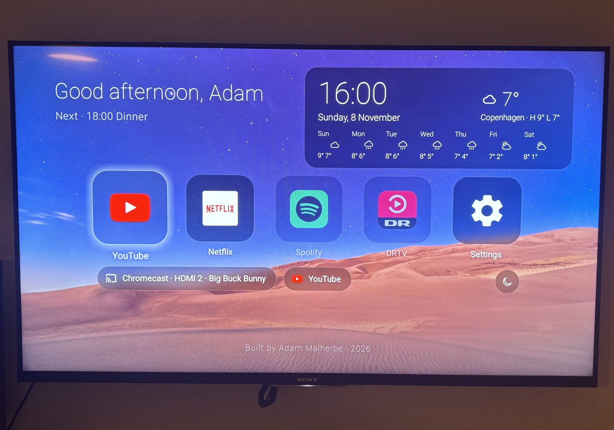

# Clean Screen TV 📺

**A calm, ad-free home screen for Android TV.**

Built because the stock Android TV home screen is full of ads and rows you never asked for. This replaces it with frosted glass tiles over slow-changing nature scenes, and only the stuff you actually use.



*Running on my own TV, with my name, city and calendar filled in. The signature at the bottom isn't in the released version.*

## What it does

- **Your apps, nothing else:** big tiles for YouTube, Netflix, Spotify, DRTV, your Chromecast and Settings
- **Continue row:** the apps you used most recently this week, one click away
- **Chromecast "now playing":** see what's casting, and get a "Back to Chromecast?" card after the TV wakes up
- **Weather:** right now plus a 7-day forecast for your city
- **Next event:** one line under the date with your next calendar event (any public iCal link, e.g. iCloud)
- **Sleep timer:** 30, 60 or 90 minutes, keeps counting even while Netflix or HDMI is on screen
- **Living background:** five nature scenes that rotate every 20 minutes, tinted for dawn, day, dusk and night
- **Greeting:** "Good evening" (with your name, if you add it)

Works offline with cached weather and calendar. No Google Play Services, no accounts, no tracking.

## What you need

- An Android TV running Android 7.0 or newer (built and tested on a Sony Android TV)
- A Mac or PC with [Android Studio](https://developer.android.com/studio) (for building and for `adb`)
- The TV and computer on the same Wi-Fi

## 1. Set it up

```bash
git clone https://github.com/adammalherbe/clean-screen-tv.git
cd clean-screen-tv
cp config.example.json config.local.json
```

Open `config.local.json` and fill it in. Everything is optional:

```json
{
  "name": "Sam",
  "city": "Cupertino",
  "latitude": "37.33",
  "longitude": "-122.01",
  "calendarUrl": "",
  "chromecastIp": ""
}
```

| Setting | What it does |
|---|---|
| `name` | Shown in the greeting. Leave empty for just "Good evening" |
| `city`, `latitude`, `longitude` | Weather and sunrise/sunset. Find yours on [latlong.net](https://www.latlong.net) |
| `calendarUrl` | A public iCal link for the "Next" line. In iCloud: Calendar → share → Public Calendar → copy link |
| `chromecastIp` | Your Chromecast's IP, for "now playing". Find it in the Google Home app |

`config.local.json` is in `.gitignore`, so your calendar link and IPs never end up on GitHub.

## 2. Turn on developer mode on the TV

1. **Settings → Device Preferences → About**, scroll to **Build** and click it 7 times
2. **Settings → Device Preferences → Developer options →** turn on **USB debugging** and **Network debugging** (the name varies by brand, sometimes "ADB debugging")
3. Find the TV's IP: **Settings → Network → Wi-Fi → your network**

## 3. Build and install

On a Mac with Android Studio installed, tell the build where Java and the Android SDK are (once per Terminal window):

```bash
export JAVA_HOME="/Applications/Android Studio.app/Contents/jbr/Contents/Home"
export ANDROID_HOME="$HOME/Library/Android/sdk"
```

Then build and install, using your TV's IP:

```bash
TV=192.168.1.50:5555 ./tools/install.sh
```

The first time, the TV asks "Allow USB debugging?". Choose **Always allow**.

The script builds the app, installs it, gives it permission for the Continue row, and opens it.

## 4. Make it your home screen

Press the **Home** button on the remote. If the TV asks which home app to use, pick **Clean Screen TV → Always**.

Some TVs (newer Google TV models especially) don't let you change the home app. Then you can still open Clean Screen TV like a normal app.

## Settings on the TV

Long-press **OK** on the **Settings** tile to open Clean Screen TV's own settings: auto-switch to the Chromecast after the TV starts, and the one-time setup for the sleep timer.

## Make it yours

- **Apps on the tiles:** edit `TILE_APPS` in `app/src/main/kotlin/dk/adam/tv/Apps.kt`. Any installed app's package name works. Apps that aren't installed yet open their Play Store page.
- **Chromecast HDMI input:** the `CHROMECAST` tile uses a Sony-specific input ID (`…/HW3` = HDMI 2). On other brands, change `inputId` or remove the tile.
- **Backgrounds:** swap the photos in `app/src/main/assets/bg/` and run `tools/prepare_images.py` to make the blurred versions.

## Is it safe?

- The sleep timer works by connecting to the TV's own network debugging (ADB) on port 5555. While network debugging is on, **other devices on your Wi-Fi can also connect to the TV** if you approve them. Only use it on a home network you trust, and never click "Allow" on a debugging prompt you didn't expect.
- Nothing is sent anywhere except the weather lookup ([Open-Meteo](https://open-meteo.com), no account) and your own calendar link.

## Troubleshooting

| Problem | Fix |
|---|---|
| "SDK location not found" | Run the two `export` lines in step 3 first |
| `adb connect` fails | Check network debugging is on and the IP is right. Some TVs need a restart after turning it on |
| Continue row is empty | Run the install script again. It grants the usage permission the TV's own menus can't |
| No "Next" line | The calendar link must be public. Private iCloud links won't work |
| Chromecast tile does nothing | Your TV isn't a Sony, or the Chromecast is on another HDMI port. See "Make it yours" |
| Sleep timer doesn't turn the TV off | Open Clean Screen TV's settings (long-press OK on Settings) and run the sleep timer setup |

## Credits

Background photos are CC0 (public domain). See [CREDITS.md](CREDITS.md).

Built with [Claude](https://claude.ai).

## License

[MIT](LICENSE). If you build your own, I'd love to see it.
